# Conception POO — « Chevalier »


## 1. Démarche

On part du GDD et on en extrait les **classes** (les « objets » du jeu), puis on les
**organise** (héritage + interfaces), et enfin on y place les **design patterns**
appropriés. Le tout est résumé visuellement dans le diagramme UML (section 9).

Deux principes guident toute la conception :

- **Séparer la logique du jeu de l'affichage** : le modèle (règles, physique, entités)
  ne dépend **pas** de JavaFX. Il est donc testable sans ouvrir de fenêtre.
- **Préférer la composition à l'héritage** quand un comportement doit varier
  (cf. Strategy, section 6.1).

Convention : tout le code (classes, méthodes, champs) est **en anglais**, la
documentation de conception en français.

---

## 2. Les classes du jeu

Classes identifiées à partir des noms du GDD :

| Rôle                                 | Classe                                   |
|--------------------------------------|------------------------------------------|
| Tout objet placé dans le niveau      | `GameObject` (abstraite)                 |
| Boîte de collision rectangulaire     | `AABB` (record)                          |
| Un objet qui bouge et a des PV       | `Entity` (abstraite)                     |
| Le chevalier (joueur)                | `Player`                                 |
| Les ennemis (slime, chauve-souris, garde) | `Enemy` + un `MovementBehavior`     |
| Une caisse cassable à l'épée         | `Crate`                                  |
| Les objets à ramasser                | `Item` (abstraite) + `Coin`, `Heart`     |
| Une case du décor                    | `TileType` (énumération)                 |
| Un niveau (grille + objets)          | `Level`                                  |
| La lecture d'un fichier de niveau    | `LevelLoader`                            |
| La création des objets du niveau     | `EntityFactory`                          |
| Ce qui est visible à l'écran         | `Camera`                                 |
| L'affichage / le rendu               | `Renderer`                               |
| L'affichage des cœurs, vies, pièces  | `HUD`                                    |
| La lecture du clavier                | `InputHandler`                           |
| Le chef d'orchestre (boucle de jeu)  | `Game`                                   |

> Il n'y a **pas** de classes `Slime`, `Bat` ou `Guard` : un type d'ennemi se définit
> par sa **stratégie de déplacement + ses stats** (voir section 6.1).

---

## 3. Hiérarchie des classes (héritage — relation « EST un »)

Les objets du jeu partagent une structure commune (position, taille, boîte de
collision, mise à jour). On factorise ce commun dans des **classes abstraites**.

```
GameObject  (abstraite)
│   Champs : x, y, width, height, removed
│   Méthodes : getBounds() : AABB
│              update(level, dt)  [abstraite]
│              isRemoved() / markRemoved()
│
├── Entity  (abstraite, implements Damageable)  « un GameObject qui bouge et a des PV »
│   │   Champs : vx, vy, hp, onGround, affectedByGravity
│   │   Comportement : gravité, déplacement + collisions, takeDamage()
│   │
│   ├── Player          le chevalier contrôlé par le joueur
│   │                   (saut, attaque à l'épée, vies, pièces, invincibilité temporaire)
│   │
│   └── Enemy           une Entity pilotée par l'IA, composée d'un MovementBehavior
│
├── Crate  (implements Damageable)    caisse immobile, cassée par l'épée, libère un Item
│
└── Item  (abstraite)                 « un GameObject qu'on ramasse » (pas de physique)
    │   Méthode : onPickup(Player)  [abstraite]
    ├── Coin                          ajoute une pièce au compteur
    └── Heart                         rend de la vie
```

**Concepts employés :**

- **Classe abstraite** : non instanciable, sert de modèle commun. `GameObject`,
  `Entity` et `Item` sont abstraites ; `Player`, `Enemy`, `Crate`, `Coin`, `Heart`
  sont concrètes.
- **Méthode abstraite** : déclarée dans le parent, **implémentée** par chaque enfant
  (`update`, `onPickup`). Une pièce et un cœur réagissent chacun à leur manière au
  ramassage.
- **Polymorphisme** : le jeu manipule une liste de `GameObject` et appelle
  `update(level, dt)` sur chacun sans connaître son type concret. Le niveau est
  **passé en paramètre** plutôt que stocké dans chaque objet : un objet n'a besoin du
  niveau que pendant sa mise à jour, et on évite ainsi les références croisées.
- **Encapsulation** : les PV sont `private` et ne changent que via `takeDamage()` /
  `heal()` ; impossible de les mettre à une valeur incohérente depuis l'extérieur.
- **Justification de la hiérarchie** : `Item` et `Crate` héritent de `GameObject` mais
  **pas** de `Entity`, car ils n'ont ni vitesse ni gravité — on évite de leur
  transmettre du code inutile. Chaque classe n'hérite que de ce dont elle a besoin.

### Gravité et chauve-souris

`Entity` applique la gravité seulement si `affectedByGravity` est vrai. La chauve-souris
est un `Enemy` créé avec `affectedByGravity = false` (par la fabrique, section 6.2) :
pas besoin d'une sous-classe pour ça.

---

## 4. Interface `Damageable` (capacité — relation « PEUT faire »)

Certaines capacités sont **transversales** : elles concernent des classes situées dans
des **branches différentes** de l'arbre. On les exprime par une **interface**
(contrat), pas par l'héritage.

| Interface    | Contrat                                     | Implémentée par                |
|--------------|---------------------------------------------|--------------------------------|
| `Damageable` | `takeDamage(int amount)`, `isDead()`        | `Entity` (donc `Player`, `Enemy`) et `Crate` |

`Entity` et `Crate` sont dans deux branches distinctes (une caisse n'est pas une
entité : elle ne bouge pas), pourtant **toutes deux peuvent être frappées**.

**Exemple d'intérêt** : l'attaque à l'épée cible tout objet `Damageable` que sa hitbox
touche, sans se soucier de son type concret (slime, garde, caisse). Ajouter plus tard
un nouvel objet cassable (tonneau, mur fragile) ne demande **aucune modification** du
code de l'attaque : il suffit d'implémenter `Damageable`. Code **ouvert à l'extension,
fermé à la modification** (principe Open/Closed).

**Règle de décision :**
- Point commun de **nature / structure** (position, PV, vitesse…) → **héritage**.
- Point commun de **capacité** partagée entre branches différentes → **interface**.

> Pourquoi pas d'interface `Collectible` ? Seuls les `Item` sont ramassables, et ils
> ont déjà un parent commun qui déclare `onPickup()`. Une interface ferait doublon
> avec la classe abstraite `Item`.

---

## 5. Représentation du décor : `TileType` (énumération)

Un niveau contient des milliers de tuiles mais seulement quelques **types**. Plutôt
qu'une classe par tuile, on utilise une **énumération** :

```java
enum TileType {
    EMPTY('.', false), GROUND('#', true), PLATFORM('=', true),
    SPIKES('^', false), EXIT('E', false);

    private final char symbol;
    private final boolean solid;
    // isSolid(), fromChar(char)
}
```

Chaque type sait s'il est **solide** (bloque le déplacement) et par quel caractère il
est représenté dans les fichiers de niveau. Le `Level` stocke une simple grille de
`TileType`. Les **piques** sont une tuile (immobile) : le `Game` inflige des dégâts au
joueur quand sa boîte touche une tuile `SPIKES`.

---

## 6. Design patterns

Trois patterns, de familles différentes, placés là où ils résolvent un vrai problème
du jeu (jamais forcés).

| Pattern            | Famille        | Rôle dans le jeu                                           |
|--------------------|----------------|------------------------------------------------------------|
| **Strategy**       | comportemental | comportements de déplacement des ennemis, interchangeables |
| **Simple Factory** | création       | créer les objets à partir du fichier de niveau (+ difficulté) |
| **Observer**       | comportemental | événements de jeu → HUD / son / menus                      |

### 6.1 Strategy — comportement des ennemis

**Problème** : chaque ennemi se déplace différemment (marche, vol, poursuite). Un gros
`if/else` par type serait illisible, et coller le comportement dans une sous-classe
empêche de le réutiliser ou de le changer en cours de partie.

**Solution** : on extrait le comportement dans un objet interchangeable.

```java
interface MovementBehavior {
    void move(Enemy enemy, Level level, Player player, double dt);
}

class WalkAndTurn implements MovementBehavior { ... }  // marche + demi-tour aux bords/murs
class Fly         implements MovementBehavior { ... }  // vol ondulant
class Chase       implements MovementBehavior { ... }  // fonce vers le joueur

class Enemy extends Entity {
    private MovementBehavior behavior;                  // sa stratégie

    public void setBehavior(MovementBehavior b) { this.behavior = b; }

    @Override
    public void update(Level level, double dt) {
        behavior.move(this, level, level.getPlayer(), dt);  // délégation
        super.update(level, dt);                            // gravité + collisions
    }
}
```

**Apports** : comportements **interchangeables** (on compose `Enemy` + stratégie),
**réutilisables** (`Chase` sert à la chauve-souris et à un futur boss), **changeables à
chaud** (la chauve-souris passe de `Fly` à `Chase` quand le joueur s'approche, via
`setBehavior`), et **testables** isolément.

**Décision de conception — composition plutôt qu'héritage** : avec Strategy, des
sous-classes `Slime` / `Bat` / `Guard` n'apporteraient rien. Un ennemi se définit par
sa **stratégie + ses stats** :

| Ennemi        | Stratégie              | PV | Gravité |
|---------------|------------------------|----|---------|
| Slime         | `WalkAndTurn`          | 1  | oui     |
| Chauve-souris | `Fly` → `Chase`        | 1  | non     |
| Garde         | `WalkAndTurn`          | 2  | oui     |

Ces combinaisons sont fabriquées par l'`EntityFactory` (section 6.2).

**Détail d'implémentation** : une stratégie ne stocke rien de propre à un ennemi (la
direction est un champ de `Enemy`, modifiée via `turnAround()`). Une même instance
de stratégie peut donc être partagée par plusieurs ennemis — d'où l'**agrégation**
(◇) et non la composition dans l'UML. `WalkAndTurn` fait demi-tour face à un mur
**ou au bord d'un vide** : le slime ne tombe jamais dans les trous.

**Changement de stratégie à chaud (chauve-souris)** : `Fly` patrouille en ondulant
autour de son point d'ancrage ; dès que le joueur est à moins de 5 tuiles, elle
appelle `enemy.setBehavior(new Chase(...))`. L'ennemi reste le même objet, seul son
comportement change. `Fly` est la seule stratégie **avec état** (son point
d'ancrage) : chaque chauve-souris a sa propre instance. `Chase` fonce en 2D pour un
volant, et seulement à l'horizontale pour un ennemi soumis à la gravité.
Le **garde** réutilise `WalkAndTurn` (plus lent) avec 2 PV : aucune classe nouvelle,
seulement une autre combinaison dans la fabrique.

### 6.2 Simple Factory — création des objets du niveau

**Problème** : charger un niveau depuis un fichier texte implique de transformer chaque
caractère en objet (`S`→slime, `C`→pièce, `P`→joueur…). Éparpiller les `new` dans le
chargeur de niveau mélange lecture de fichier et logique de création.

**Solution** : centraliser la création dans une fabrique. Le `LevelLoader` lit le
fichier ; pour chaque caractère, il demande d'abord à `TileType` si c'est une tuile,
sinon il le passe à la fabrique.

```java
class EntityFactory {
    Optional<GameObject> create(char symbol, double x, double y, int levelNumber) {
        return switch (symbol) {
            case 'P' -> Optional.of(new Player(x, y));
            case 'S' -> Optional.of(makeSlime(x, y, levelNumber));  // stats selon le niveau
            case 'B' -> Optional.of(makeBat(x, y, levelNumber));    // affectedByGravity = false
            case 'G' -> Optional.of(makeGuard(x, y, levelNumber));  // 2 PV
            case 'X' -> Optional.of(new Crate(x, y, makeCoin(x, y)));  // caisse contenant une pièce
            case 'C' -> Optional.of(new Coin(x, y));
            case 'H' -> Optional.of(new Heart(x, y));
            default  -> Optional.empty();                           // caractère inconnu
        };
    }
}
```

**Apports** : logique de création **centralisée** (un seul endroit), **extensible**
(ajouter un ennemi = ajouter un `case`), **découplage** (`LevelLoader` ne connaît pas
les classes concrètes). **Bonus** : la **difficulté croissante** (ennemis plus rapides
ou plus résistants dans les derniers niveaux) vit ici, à un seul endroit.

`Optional` plutôt que `null` : l'appelant est obligé de traiter le cas « caractère
inconnu » (le `LevelLoader` lève alors une `InvalidLevelException` avec le numéro de
ligne), ce qui évite les `NullPointerException`.

> **Précision de vocabulaire** : il s'agit d'une **Simple Factory** (une classe dont le
> rôle est de créer des objets), et non du *Factory Method* du GoF (qui repose sur une
> méthode de création redéfinie dans des sous-classes). Le principe recherché est le
> même : isoler la création des objets de leur utilisation.

### 6.3 Observer — événements de jeu

**Problème** : à la collecte d'une pièce, le HUD doit se mettre à jour ; à la mort,
afficher l'écran de game over. Appeler l'interface graphique directement depuis la
logique de jeu les rend inséparables (et la logique devient intestable sans GUI).

**Solution** : le jeu (le **sujet**) **publie** des événements ; les intéressés
(les **observateurs**) **s'abonnent**.

```java
interface GameListener {
    void onTitleScreen();
    void onPauseChanged(boolean paused);
    void onLevelStarted(int levelNumber);
    void onHeartsChanged(int hearts, int maxHearts);
    void onLivesChanged(int lives);
    void onCoinsChanged(int coins);
    void onLevelCompleted(int levelNumber);
    void onVictory(int coins);
    void onGameOver();
}

class Game {
    private final List<GameListener> listeners = new ArrayList<>();

    public void addListener(GameListener l)    { listeners.add(l); }
    public void removeListener(GameListener l) { listeners.remove(l); }

    private void notifyLivesChanged(Player p) {
        for (GameListener l : listeners) l.onLivesChanged(p.getLives());
    }
    // notifyHeartsChanged, onGameOver...
    // addListener envoie aussi l'état actuel au nouvel abonné (pour qu'il s'affiche).
}

class HUD implements GameListener { ... }   // met à jour l'affichage
```

La logique de jeu se contente de **notifier** ses abonnés, sans savoir qui écoute. Un
`SoundManager` pourrait s'abonner de la même façon sans modifier `Game`.

**Apports** : **découplage** logique ↔ affichage (dans les tests, on abonne un faux
listener qui enregistre les événements reçus, sans aucune fenêtre), **plusieurs
abonnés** possibles (HUD, son, succès) sans toucher à la logique.
**Bonus** : **JavaFX est lui-même fondé sur l'Observer** — ses `Property`
(ex. `IntegerProperty`) sont observables et un `Label` peut s'y **lier** (`bind`).
Le `HUD` peut stocker ses valeurs dans des `Property` et y lier ses labels.

---

## 7. Séparation modèle / affichage (rendu)

Les objets du modèle **ne se dessinent pas eux-mêmes** : ils n'ont pas de méthode
`render(GraphicsContext)`, sinon tout le modèle dépendrait de JavaFX et ne pourrait
pas être testé sans fenêtre. Ils exposent seulement un **identifiant de sprite**
(`getSpriteId()` : `"player"`, `"slime"`, `"coin"`…).

Le rendu (fidèle à la maquette, entièrement dessiné en code) est découpé par rôle :

| Classe | Rôle |
|---|---|
| `Renderer` | chef d'orchestre : fond → tuiles visibles → objets, décalés par la `Camera` |
| `Background` | ciel en dégradé, lune et collines en **parallaxe** |
| `TilePainter` | terre avec de l'herbe sur le dessus, plateformes, piques, porte |
| `SpritePainter` (interface) | « sait dessiner un objet » : `paint(gc, object, time)` |
| `KnightPainter`, `SlimePainter`, `BatPainter`, `GuardPainter`, `CoinPainter`, `HeartPainter`, `CratePainter` | un peintre par apparence, en quelques formes simples (rectangles, ovales) |
| `Palette` | toutes les couleurs de la maquette, en un seul endroit |

Le `Renderer` tient une table **identifiant → `SpritePainter`** : ajouter l'apparence
d'un nouvel objet revient à écrire un peintre et à l'enregistrer (`register`), sans
modifier le reste du rendu (Open/Closed). Un objet sans peintre s'affiche en magenta
pour être repéré, et un test (`RendererTest`) vérifie que chaque objet que la fabrique
sait créer possède un peintre.

---

## 8. Organisation en packages

```
src/main/java/chevalier/
├── model/              ← logique pure, AUCUNE dépendance à JavaFX (testable)
│   ├── GameObject, AABB, Damageable
│   ├── entity/         Entity, Player, Enemy, Crate, Item, Coin, Heart
│   ├── behavior/       MovementBehavior, WalkAndTurn, Fly, Chase
│   └── level/          Level, TileType, LevelLoader, EntityFactory, InvalidLevelException
├── controller/         Game, GameState, GameListener, LevelProvider, InputHandler, Action, FixedTimestep
└── view/               Renderer, Camera, HUD, Background, TilePainter, Palette
    └── sprite/         SpritePainter + un peintre par apparence
```

C'est une organisation de type **MVC** (Modèle – Vue – Contrôleur) : la vue observe le
contrôleur (Observer), le contrôleur pilote le modèle, et le modèle ignore tout des
deux autres.

---

## 9. Diagramme UML (classes)

Vue d'ensemble des classes et de leurs relations. Les trois design patterns y
apparaissent explicitement (exigence du sujet) :
- **Strategy** : `Enemy o-- MovementBehavior` (+ ses implémentations)
- **Simple Factory** : `LevelLoader ..> EntityFactory ..> GameObject`
- **Observer** : `Game o-- GameListener <|.. HUD`

Notation :

| Flèche  | Signification                                               |
|---------|-------------------------------------------------------------|
| `<\|--` | héritage (« EST un »)                                       |
| `<\|..` | implémente une interface                                    |
| `*--`   | composition (la partie n'existe pas sans le tout)           |
| `o--`   | agrégation (le tout référence la partie, qui peut être partagée ou remplacée) |
| `..>`   | dépendance (« utilise » / « crée »)                         |

```mermaid
classDiagram
    direction LR

    %% ===== Modèle : base =====
    class AABB {
        <<record>>
        +double x
        +double y
        +double width
        +double height
        +intersects(AABB other) boolean
    }
    class GameObject {
        <<abstract>>
        #double x
        #double y
        #double width
        #double height
        -boolean removed
        +getBounds() AABB
        +update(Level level, double dt)*
        +getSpriteId() String*
        +isRemoved() boolean
        +markRemoved()
    }
    class Damageable {
        <<interface>>
        +takeDamage(int amount)
        +isDead() boolean
    }

    %% ===== Modèle : entités =====
    class Entity {
        <<abstract>>
        #double vx
        #double vy
        -int hp
        #boolean onGround
        #boolean affectedByGravity
        +takeDamage(int amount)
        +isDead() boolean
        +heal(int amount)
        +setAffectedByGravity(boolean affected)
        #applyGravity(double dt)
        #moveAndCollide(Level level, double dt)
    }
    class Player {
        -int lives
        -int coins
        -double invincibilityTimer
        +hurt(int amount) boolean
        +isInvincible() boolean
        +loseLife()
        +setMoveDirection(int direction)
        +setJumpHeld(boolean held)
        +setAttackHeld(boolean held)
        +getAttackHitbox() Optional~AABB~
        +strike(Damageable target) boolean
        +respawn()
        +addCoins(int amount)
        +inheritProgress(Player previous)
    }
    class Enemy {
        -String spriteId
        -MovementBehavior behavior
        -int contactDamage
        -int direction
        +setBehavior(MovementBehavior b)
        +setVelocity(double vx, double vy)
        +turnAround()
        +isHurt() boolean
        +update(Level level, double dt)
    }
    class Crate {
        -Item loot
        +getLoot() Optional~Item~
        -int hp
        +takeDamage(int amount)
        +isDead() boolean
    }
    class Item {
        <<abstract>>
        +onPickup(Player p)*
    }
    class Coin {
        +onPickup(Player p)
    }
    class Heart {
        +onPickup(Player p)
    }

    %% ===== Strategy =====
    class MovementBehavior {
        <<interface>>
        +move(Enemy e, Level lvl, Player p, double dt)
    }
    class WalkAndTurn {
        -double speed
    }
    class Fly {
        -double anchorX
        -double anchorY
        -double speed
        -double chaseSpeed
    }
    class Chase {
        -double speed
    }

    %% ===== Niveau + Simple Factory =====
    class TileType {
        <<enumeration>>
        EMPTY
        GROUND
        PLATFORM
        SPIKES
        EXIT
        +isSolid() boolean
        +fromChar(char c)$ TileType
    }
    class Level {
        -int number
        -TileType[][] tiles
        -List~GameObject~ objects
        -Player player
        +addObject(GameObject o)
        +removeMarkedObjects()
        +getPlayer() Player
        +getPixelWidth() double
        +getTile(int col, int row) TileType
        +isSolidAt(double x, double y) boolean
        +getObjects() List~GameObject~
    }
    class LevelLoader {
        +load(String path, int number) Level
    }
    class EntityFactory {
        +create(char symbol, double x, double y, int levelNumber) Optional~GameObject~
    }

    %% ===== Contrôleur + Observer =====
    class GameListener {
        <<interface>>
        +onTitleScreen()
        +onPauseChanged(boolean paused)
        +onLevelStarted(int levelNumber)
        +onHeartsChanged(int hearts, int maxHearts)
        +onLivesChanged(int lives)
        +onCoinsChanged(int coins)
        +onLevelCompleted(int levelNumber)
        +onVictory(int coins)
        +onGameOver()
    }
    class GameState {
        <<enumeration>>
        MENU
        PLAYING
        PAUSED
        LEVEL_COMPLETE
        VICTORY
        GAME_OVER
    }
    class LevelProvider {
        <<interface>>
        +load(int number) Level
    }
    class Game {
        -List~GameListener~ listeners
        +addListener(GameListener l)
        +removeListener(GameListener l)
        +Game(LevelProvider levels, int levelCount, InputHandler input)
        +start(Renderer r, Camera c)
        ~update(double dt)
        ~nextLevel()
        ~restart()
        -applyRules(Player p)
        -resolveSword(Player p)
        -notifyHeartsChanged(Player p)
    }
    class InputHandler {
        +isPressed(KeyCode key) boolean
        +isActive(Action action) boolean
        +wasPressed(Action action) boolean
        +endStep()
    }
    class Action {
        <<enumeration>>
        LEFT
        RIGHT
        JUMP
        ATTACK
        PAUSE
        CONFIRM
    }
    class FixedTimestep {
        +STEP$ double
        +advance(double elapsed) int
    }

    %% ===== Vue =====
    class Renderer {
        -Map~String,SpritePainter~ painters
        +render(Level lvl, Camera cam)
        +register(String spriteId, SpritePainter p)
    }
    class SpritePainter {
        <<interface>>
        +paint(GraphicsContext gc, GameObject o, double time)
    }
    class KnightPainter
    class SlimePainter
    class Background
    class TilePainter
    class Camera {
        -double x
        -double y
        +follow(Player p, Level lvl)
    }
    class HUD

    %% Héritage (EST un)
    GameObject <|-- Entity
    GameObject <|-- Crate
    GameObject <|-- Item
    Entity <|-- Player
    Entity <|-- Enemy
    Item <|-- Coin
    Item <|-- Heart

    %% Interface transversale (PEUT faire)
    Damageable <|.. Entity
    Damageable <|.. Crate
    Crate o-- Item : loot
    Player ..> Damageable : frappe
    GameObject ..> AABB : getBounds

    %% Strategy
    Enemy o-- MovementBehavior : behavior
    MovementBehavior <|.. WalkAndTurn
    MovementBehavior <|.. Fly
    MovementBehavior <|.. Chase
    Fly ..> Chase : bascule vers (setBehavior)

    %% Niveau + Simple Factory
    Level *-- TileType : tiles
    Level *-- GameObject : objects
    LevelLoader ..> EntityFactory : utilise
    LevelLoader ..> Level : crée
    EntityFactory ..> GameObject : crée

    %% Observer
    Game o-- GameListener : listeners
    GameListener <|.. HUD

    %% Contrôleur
    Game o-- Level : niveau courant
    Game o-- LevelProvider : levels
    LevelProvider ..> LevelLoader : (Main) délègue à
    Game *-- InputHandler
    Game ..> Renderer : start()
    Game ..> Camera : start()
    Renderer *-- Background
    Renderer *-- TilePainter
    Renderer o-- SpritePainter : painters
    SpritePainter <|.. KnightPainter
    SpritePainter <|.. SlimePainter
    SpritePainter ..> GameObject : dessine
    Game *-- FixedTimestep
    Game --> GameState : state
    InputHandler ..> Action : traduit les touches en
```


